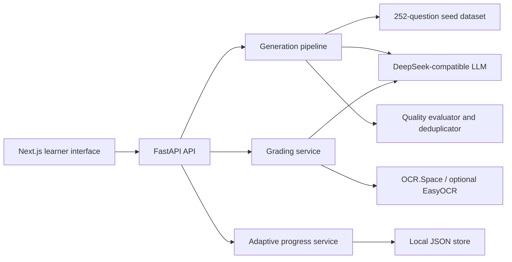

# T2P AI Mentor

[](https://github.com/2766089255-dot/T2P/actions/workflows/ci.yml)

T2P is an end-to-end calculus learning assistant that generates targeted exercises, checks response quality, grades typed or handwritten work, and adapts the next activity to each learner's progress.

The repository contains a FastAPI backend, a Next.js interface, a 252-question curated seed dataset spanning 13 calculus topics, and a modular generation/evaluation pipeline.

## Highlights

- Generates calculation, multiple-choice, and fill-in questions in drill or exam mode.
- Uses a self-correcting pipeline: prompt construction → LLM generation → JSON repair → quality evaluation → feedback-guided retry.
- Grades typed answers and image submissions; image answers are OCR'd before LLM evaluation.
- Tracks mastery with an exponential moving average and recommends topic, level, and mode for the next task.
- Renders mathematical notation with KaTeX and visualizes progress with Recharts.
- Exposes validated FastAPI endpoints and interactive OpenAPI documentation.
- Deduplicates generated questions with multilingual sentence embeddings, with a lightweight text-fingerprint fallback.

## Architecture



## Technology stack

- Backend: Python, FastAPI, Pydantic, OpenAI-compatible SDK
- AI pipeline: prompt engineering, structured-output repair, automated quality checks, retry feedback
- Retrieval and quality: curated golden examples, Sentence Transformers, semantic deduplication
- Frontend: Next.js, React, TypeScript, Tailwind CSS, KaTeX, Recharts
- Persistence: JSON-based progress and generated-question stores

## Quick start

### 1. Backend

Python 3.10 or newer is recommended.

```bash
python -m venv .venv
.venv\Scripts\activate
python -m pip install -r requirements.txt
copy .env.example .env
```

Add a valid `DEEPSEEK_API_KEY` to `.env`, then start the API:

```bash
python api_server.py
```

The API runs at `http://127.0.0.1:8001`; interactive documentation is available at `http://127.0.0.1:8001/docs`.

The server can start without an API key so that the dataset, topics, and local health endpoints remain inspectable. Generation and grading return a clear `503` response until a key is configured.

For image grading, `OCR_SPACE_API_KEY=helloworld` enables the provider's public demo key. Register a personal free key and replace this value for regular use. The backend validates and compresses large phone photos to fit the free plan's 1 MB source-file limit. `OCR_SPACE_TRUST_ENV=false` avoids TLS failures caused by incompatible inherited proxy settings; set it to `true` only when the deployment must use an environment-configured proxy.

### 2. Frontend

```bash
cd t2p-web
npm install
npm run dev
```

Open `http://localhost:3000`. To use a different backend URL, set `NEXT_PUBLIC_API_URL` in `t2p-web/.env.local`.

## API overview

| Endpoint | Purpose |
| --- | --- |
| `GET /health` | Check local readiness without spending provider tokens |
| `GET /health?check_provider=true` | Optionally verify the configured LLM provider |
| `GET /topics` | List supported calculus topics |
| `POST /generate` | Generate and quality-check new exercises |
| `POST /audit` | Grade typed or OCR-extracted student work |
| `POST /user/login` | Create or load local learner progress |
| `POST /user/record` | Update mastery after an attempt |
| `GET /user/progress/{user_id}` | Retrieve mastery and activity counts |

## Command-line examples

List the seed topics:

```bash
python main.py --list-topics
```

Generate three derivative exercises:

```bash
python main.py --mode drill --topics "Derivatives and Differentiation" --num 3 --difficulty 3
```

## Verification

GitHub Actions runs the offline backend suite on Python 3.12 and 3.13, generates
a dataset-audit report, and checks frontend lint, route-aware TypeScript, and
production builds on Node.js 24 for pull requests and pushes to `main`.
See [CONTRIBUTING.md](CONTRIBUTING.md) for the lightweight test setup, review
workflow, and coverage limits, and [CHANGELOG.md](CHANGELOG.md) for release notes.

```bash
python -m unittest discover -s tests -v
cd t2p-web
npm run lint
npm run typecheck
npm run build
```

The unit tests use fake AI dependencies and do not make paid API requests.

Run the deterministic, offline dataset audit from the repository root:

```bash
python audit_dataset.py --dataset data/golden_dataset_v3.json --output-dir reports
```

The generated Markdown and JSON reports are kept outside version control because they contain timestamps and can be reproduced at any time. The audit checks schema coverage, identifier uniqueness, duplicate statements, question-type constraints, scaffolding structure, and common LaTeX defects without calling DeepSeek or OCR.Space.

## Privacy and limitations

- This is an educational prototype, not an authoritative assessment system.
- OCR.Space is an external service; submitted images may leave the local machine. Install and enable a local OCR backend before using sensitive student work.
- The configured DeepSeek chat model is text-only. Image grading depends on OCR quality.
- Local JSON persistence is suitable for a demonstration, not a multi-user production deployment.
- Do not commit `.env`, generated user records, model caches, or student submissions.
